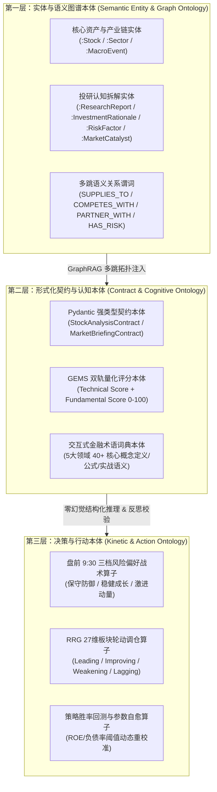
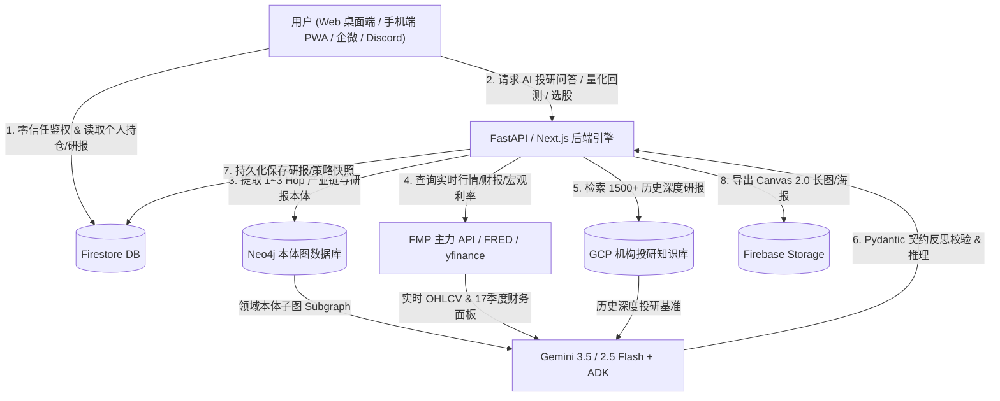
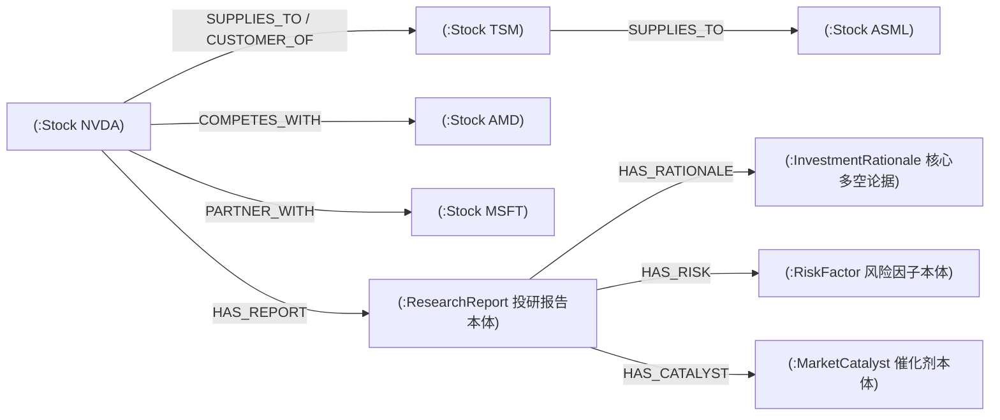
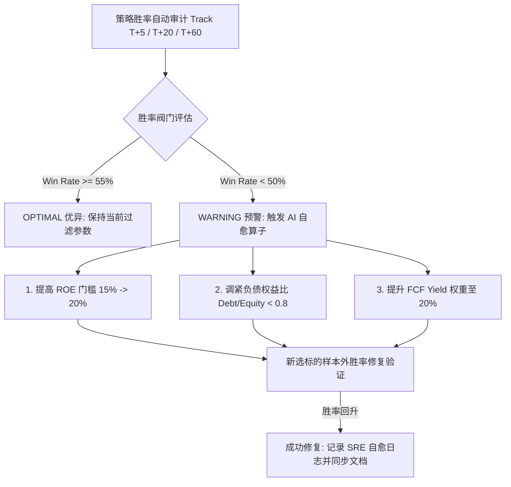

# Gems & DailyStock 算法、金融领域本体论与多模态数据架构白皮书
*(Project Algorithm, Financial Domain Ontology & Multimodal Data Architecture Whitepaper — v3.0)*

---

## 目录
1. [核心架构哲学：三层金融领域本体论 (Three-Layer Financial Domain Ontology)](#1-核心架构哲学三层金融领域本体论-three-layer-financial-domain-ontology)
2. [异构多模态数据库架构与数据协同关系](#2-异构多模态数据库架构与数据协同关系)
3. [Neo4j 领域知识图谱本体 (GraphRAG Ontology) 五大实体与四类关系拓扑](#3-neo4j-领域知识图谱本体-graphrag-ontology-五大实体与四类关系拓扑)
4. [量化选股、RRG 轮动与实盘操盘 6 大核心维度](#4-量化选股rrg-轮动与实盘操盘-6-大核心维度)
5. [机构级步进回测引擎 (Walk-Forward Backtest Lab) 与统计检验](#5-机构级步进回测引擎-walk-forward-backtest-lab-与统计检验)
6. [闭环胜率评估算法与七重自主自愈机制 (Autonomous SRE Loops)](#6-闭环胜率评估算法与七重自主自愈机制-autonomous-sre-loops)

---

## 1. 核心架构哲学：三层金融领域本体论 (Three-Layer Financial Domain Ontology)

在传统的 AI 投研系统中，大语言模型（LLM）直接面对散乱的行情 JSON、新闻碎片与非结构化财报文本，极易产生“金融幻觉（Hallucination）”或缺乏可执行的交易逻辑。**Gems & DailyStock** 借鉴了企业级知识工程与 **Palantir Foundry / AIP 本体论（Ontology）** 的神经符号（Neuro-Symbolic）架构思想，在底层原始数据（Data Layer）与上层生成式 AI 智能体（Agent Layer）之间，构建了严谨的**三层金融领域本体（Three-Layer Financial Domain Ontology）**：

### 1.1 第一层：语义实体与关系图谱本体 (Semantic Entity & Graph Ontology — "Nouns & Verbs")
定义美股市场中客观存在的**领域实体类（Entity Classes）**与**语义关系谓词（Object Properties）**。通过 `Neo4jGraphService` 将孤立的股票代码转化为具备上下游供应链传导（`SUPPLIES_TO` / `CUSTOMER_OF`）、同赛道竞品博弈（`COMPETES_WITH`）、生态战略绑定（`PARTNER_WITH`）以及投研逻辑拆解（`HAS_RATIONALE`、`HAS_RISK`、`HAS_CATALYST`）的动态语义网络。

### 1.2 第二层：形式化契约与双语认知本体 (Contract & Cognitive Lexicon Ontology — "Rules & Schemas")
- **Pydantic 强契约本体 (`models.py`)**：系统拒绝无约束的自由文本输出，通过 `StockAnalysisContract`、`MarketBriefingContract`、`VideoScriptContract` 等形式化 Schema 定义 AI 推理的“单一事实来源（Single Source of Truth）”，强制要求每个研判结论必须绑定量化支撑位 (`key_supports`)、阻力位 (`key_resistances`)、多空情绪极性 (`sentiment`) 与核心催化因子 (`key_catalysts`)。
- **金融术语认知本体 (`TermTooltip.jsx`)**：在前端与研报阅读器中内置涵盖**量价技术、基本面与财报 NLP、宏观与 RRG 轮动、量化回测统计、选股策略流派** 5 大领域的术语本体库，将每个专业概念形式化为 `{ summary: 概念定义, practical: 实战操盘含义, formula: 数学公式与阈值 }`，实现机器推理语义与投资者阅读认知的无缝对齐。

### 1.3 第三层：动力学与行动本体 (Kinetic & Action Ontology — "Decisions & Self-Healing")
本体不仅描述“世界是什么”，更定义“在特定状态下应当执行什么动作”：
- **盘前异动战术算子 (`PremarketAnomalyService`)**：将盘前跳空、量比激增、WSB 散户情绪与做空比 (`Short Float`) 形式化映射为 `SHORT_SQUEEZE`（逼空加速）、`GAP_AND_GO`（跳空突破）等标准战术态势，并针对 `conservative`（保守型）、`moderate`（稳健型）、`aggressive`（激进型）三类投资者自动生成差异化的 9:30 AM 开盘攻防指令。
- **RRG 轮动与风险再平衡算子 (`RotationSignalEngine` & `SectorActionEngine`)**：根据 27 个行业 ETF 在相对强度（RS-Ratio）与相对动量（RS-Momentum）空间的运动轨迹，自动触发行业超配/低配与 60/40 股债漂移预警。

---

## 2. 异构多模态数据库架构与数据协同关系

系统采用了 **NoSQL 文档数据库 + 关系图谱本体库 + 云端私有投研库 + 对象存储 + 内存级熔断缓存** 的五维异构多模态存储架构：

| 存储组件 | 数据库类型 | 核心职责与保存的内容 |
| :--- | :--- | :--- |
| **Google Cloud Firestore** | NoSQL 文档数据库 *(核心业务主库)* | • **用户与权限**：用户 Profile (`users/`)、Firebase 零信任鉴权、订阅等级与推送偏好。 • **研报与历史归档**：每日持仓与观察池简报 (`reports/`)、每周审计周报 (`weekly_cache/`)、宏观分析 (`macro_cache/`)、财报 NLP 深度拆解 (`earnings_archive/`)。 • **策略与快照**：Gems 策略快照 (`gems_rebalance_snapshots/`)、60/40 股债漂移监控、SRE 健康探针状态 (`system_status`)。 |
| **Neo4j (AuraDB)** | 图数据库 *(GraphRAG 本体引擎)* | • **产业链上下游本体拓扑**：如 `NVDA → TSM → ASML`、`AAPL → Foxconn`。 • **多跳传导图谱 (1~3 Hops)**：板块溢出效应、竞争对手替代关系、战略合作同盟。 • **结构化研报认知图谱**：将非结构化研报拆解为 `:ResearchReport`、`:InvestmentRationale`、`:RiskFactor`、`:MarketCatalyst` 四类本体节点。 |
| **GCP 机构投研金库 (GCP Research Vault)** | 云端投研文档与向量检索库 | • **1500+ 篇机构级深度美股研报归档**：支持按股票代码、行业、日期与投研主题毫秒级全文检索、在线阅读与微信排版导出。 |
| **Firebase Storage** | 对象存储 (Object Storage) | • **多模态媒体与渲染产物**：Canvas 2.0 高清分享卡片 PNG、6-Slide 财报 PPT 海报、微信公众号 HTML 预览页。 |
| **内存/本地熔断缓存** | In-Memory Stateful Cache | • **高频行情与问答热缓存**：FMP 实时报价、VWAP、SMA/RSI 缓存，以及 `UnifiedQAEngine` 5 分钟线程安全热缓存。 • **Circuit Breaker 状态机**：主数据源故障时的秒级无感降级保护。 |

### 数据协同架构图 (Data Synergy Architecture)

---

## 3. Neo4j 领域知识图谱本体 (GraphRAG Ontology) 五大实体与四类关系拓扑

在 [`backend/neo4j_service.py`](../backend/neo4j_service.py) 中，系统通过 Cypher 定义了严格的金融图谱本体 Schema：

1. **上下游供应链传导关系 (`SUPPLIES_TO` / `CUSTOMER_OF`)**
   - 建模晶圆代工、光刻设备、封装测试及云厂商算力采购拓扑（例如 `NVDA -[SUPPLIES_TO]-> TSM -[SUPPLIES_TO]-> ASML`）。当上游产能或资本开支（CapEx）发生异动时，自动通过 2-Hop 子图遍历推导下游供给与毛利影响。
2. **同赛道竞品博弈关系 (`COMPETES_WITH`)**
   - 建模同行业直接竞争对手（例如 `NVDA -[COMPETES_WITH]-> AMD`、`MSFT -[COMPETES_WITH]-> GOOGL`），在财报披露季自动评估市场份额挤压或板块共振效应。
3. **深度战略生态伙伴关系 (`PARTNER_WITH`)**
   - 建模跨行业资本与 AI 算力生态同盟（例如 `MSFT -[PARTNER_WITH]-> OpenAI`），捕捉非传统买卖关系下的生态护城河。
4. **投研报告认知拆解图谱 (`HAS_REPORT` / `HAS_RATIONALE` / `HAS_RISK` / `HAS_CATALYST`)**
   - 将每篇定性深度研报解构为带有 `technicalScore` 与 `fundamentalScore` 的 `:ResearchReport` 实体，并挂载独立的 `:InvestmentRationale`（投资逻辑）、`:RiskFactor`（风险因子）与 `:MarketCatalyst`（催化事件）本体节点，供 `UnifiedQAEngine` 在多轮问答中精准召回。

---

## 4. 量化选股、RRG 轮动与实盘操盘 6 大核心维度

系统中的量化选股与实盘操盘体系由 **6 大核心数据维度** 协同驱动：

### ① 宏观经济、美债流动性与两阶段反应 (Macro, Liquidity & Phase-2 Reaction)
- **数据源**：美联储 FRED 官方接口 + FMP 宏观经济日历。
- **核心指标**：联邦基金基准利率 (`FEDFUNDS`)、CPI/PCE 通胀、非农就业 (`NFP`)、10Y-2Y 美债收益率利差 (`T10Y2Y`)、10 年期美债收益率 (`DGS10`) 及市场真实广度 (`Market Breadth`)。
- **P1 / P2 双阶段事件追踪**：针对重磅宏观事件（如 FOMC 决议、CPI 发布），系统在数据公布后 $T+0.5\text{h}$ 自动生成 **Phase 1 (P1) 即时快报**，并在 $T+4.0\text{h}$ 生成 **Phase 2 (P2) 机构消化后二阶段真实趋势定调报告**，识别“假突破/诱多诱空”后的真实资金流向。

### ② RRG 27 维全行业相对轮动图谱 (27-Sector Relative Rotation Graph)
- **全行业覆盖**：同时追踪 **11 大标普 GICS 一级行业 ETF**（`XLK`, `XLF`, `XLV`, `XLY`, `XLC`, `XLI`, `XLP`, `XLE`, `XLU`, `XLRE`, `XLB`）与 **16 大高 Alpha 核心主题 ETF**（半导体 `SMH`、软件 `IGV`、AI 与机器人 `BOTZ`、网络安全 `CIBR`、云计算 `SKYY`、互联网 `FDN`、生物科技 `XBI`、医疗器械 `IHI`、国防军工 `ITA`、铀矿核能 `URA`、黄金矿业 `GDX`、铜矿 `COPX`、清洁能源 `ICLN`、房屋建筑 `ITB`、零售 `XRT`、区域银行 `KRE`）。
- **四象限动态轨迹**：以 `SPY` 为基准计算 **RS-Ratio（相对强度）** 与 **RS-Momentum（相对动量）**，绘制 5 周历史迁移尾巴，将板块实时定位至 **🟢 领涨 (Leading)**、**🔵 转强 (Improving)**、**🟡 转弱 (Weakening)**、**🔴 落后 (Lagging)** 四大象限。

### ③ 定量基本面评分维度 (Quantitative Fundamental Score: 0–100)
$$\text{Fundamental Score} = \text{ROE}(15\%) + \text{Gross Margin}(15\%) + \text{Revenue YoY}(20\%) + \text{EPS YoY}(20\%) + \text{FCF Yield}(20\%) + \text{Current Ratio}(10\%)$$
- 覆盖盈利护城河（30%）、业绩成长爆发力（40%）与现金流及资产负债安全边际（30%），并对极端异常值进行平滑截断归一化。

### ④ 技术面与动量量化维度 (Technical Score: 0–100 & Minervini Redline)
$$\text{Technical Score} = 50\text{SMA偏离度得分}(40\%) + 200\text{SMA偏离度得分}(30\%) + 52\text{周高低点位置得分}(30\%)$$
- **Minervini 趋势红线**：若当前股价跌破 200 日均线超过 20%，200SMA 趋势得分强制归零，严防在长期下降通道中盲目接飞刀。
- **盘前 9:30 AM 攻防剧本**：融合盘前跳空缺口 (`Gap %`)、成交量异动、WSB 散户热度、做空浮筹比 (`Short Float`) 与 VWAP 分时均线，输出三档风险偏好的实盘开盘预案。

### ⑤ 财报预期差与高管电话会 NLP 语调分析 (Earnings Surprise & Executive NLP)
- 自动抓取季报实际 EPS / Revenue 与华尔街一致预期的惊喜度差值（`Surprise %`），并对管理层财报电话会（Earnings Call Transcript）进行 NLP 语调极性、指引置信度与资本开支关键词拆解。

### ⑥ 60/40 股债漂移预警与组合压力测试 (Rebalance Radar & Stress Testing)
- 在月末/季末前 $T-5$ 与 $T-2$ 交易日监控 `SPY` 与 `BND` 的累计收益差值，超过 $\pm 3.0\%$ 即触发机构季末强制再平衡预警；支持科技股估值修正、鹰派加息冲击、通胀反弹与地缘升级 4 大宏观情景的持仓压力测试。

---

## 5. 机构级步进回测引擎 (Walk-Forward Backtest Lab) 与统计检验

为彻底杜绝传统简单回测中的“前视偏差（Look-Ahead Bias）”与“过拟合假象”，系统内置了专业级 **量化回测实验室 (`BacktestLabView` & `portfolio_report_service.py`)**：

1. **四大标准量化策略与摩擦成本建模**：
   - 支持 **多因子量化评分策略 (`multi_factor`)**、**趋势动量突破 (`momentum_breakout`)**、**RSI 极值均值回归 (`rsi_mean_reversion`)**、**50/200 SMA 双均线金叉 (`sma_crossover`)**。
   - 显式计入双边交易佣金与滑点损耗（默认 `10 bps = 0.10%`），还原真实净值曲线。
2. **严谨的机构级风险收益评估指标**：
   - **Lo (2002) 自相关修正夏普比率 (Autocorrelation-Adjusted Sharpe Ratio)**：修正日度收益率序列自相关性对年化 Sharpe 的虚高偏差，并输出显著性 $t$-statistic 与 $p$-value。
   - **全维风控指标**：索提诺比率（Sortino Ratio）、卡玛比率（Calmar Ratio）、最大回撤（Max Drawdown）及**最大回撤恢复期（Max Drawdown Duration，交易日天数）**、95% 置信度日度历史 **VaR** 与 **CVaR（条件风险价值 / Expected Shortfall）**、相对 `SPY` 的 **Alpha ($\alpha$)**、**Beta ($\beta$)** 与 **信息比率（Information Ratio）**。
3. **个股 52 周 AI 信号历史回测 (`StockSignalBacktestModal`)**：
   - 在任意个股研报卡片上一键启动该标的过去 52 周的 AI 买卖信号历史重演，直观对比“遵循 AI 信号调仓”与“被动买入持有 (Buy & Hold)”的净值曲线、胜率、盈亏比（Profit Factor）与逐笔交易明细。

---

## 6. 闭环胜率评估算法与七重自主自愈机制 (Autonomous SRE Loops)

系统实现了 **99.9% 无人值守的七重自主自愈闭环 (Seven Autonomous SRE Self-Healing Loops)**：

1. **Loop 1 — AI 契约反思自纠环 (Pydantic Reflection Engine)**：所有 Gemini 输出均经过 Pydantic 本体契约校验；若格式或字段缺失，自动构造包含 Schema Diff 的反思提示词重试（最多 3 次）。
2. **Loop 2 — 多源行情状态机熔断环 (Stateful Circuit Breaker)**：主力 FMP 接口连续失败 3 次即从 `CLOSED` 跳闸至 `OPEN`，毫秒级切换至 `yfinance` 与 Firestore 历史快照兜底。
3. **Loop 3 — 周报缓存完整性审计与自修复环 (Weekly Cache Auditor)**：每周六美东 08:00 自动比对活跃用户持仓与 `weekly_cache`，缺失项在 10:00 派发前自动补齐。
4. **Loop 4 — 策略实盘胜率演进环 (Strategy Win-Rate Evolution)**：持续追踪推荐标的在 $T+5$、$T+20$ 的真实收益期望：
   $$\text{单均期望收益 (Expectancy)} = (\text{Win Rate} \times \text{Avg Win}) - (\text{Loss Rate} \times \text{Avg Loss})$$
   当胜率跌破 $50\%$ 警戒线时，自动触发参数收紧自愈。
5. **Loop 5 — 全局未捕获异常 SRE 诊断环 (Unhandled Exception SRE Reporter)**：拦截 FastAPI 500 异常，自动上报 GCP Error Reporting 并向运维 Discord 频道推送带堆栈定位与修复建议的告警卡片。
6. **Loop 6 — Cloud Run 金丝雀灰度与自动回滚环 (Canary Auto-Rollback)**：新版本先承接 10% 流量并执行 `/api/v1/health/canary` 全链路探针（覆盖 FMP、Firestore、Neo4j、Gemini），异常即秒级回滚。
7. **Loop 7 — 架构与文档同频治理环 (Doc-Sync Governance Loop)**：当系统本体模型、量化回测算子或前端交互架构升级时，中英文白皮书、系统架构文档与 Web 用户手册同步更新，确保“代码即文档、文档即架构”。
