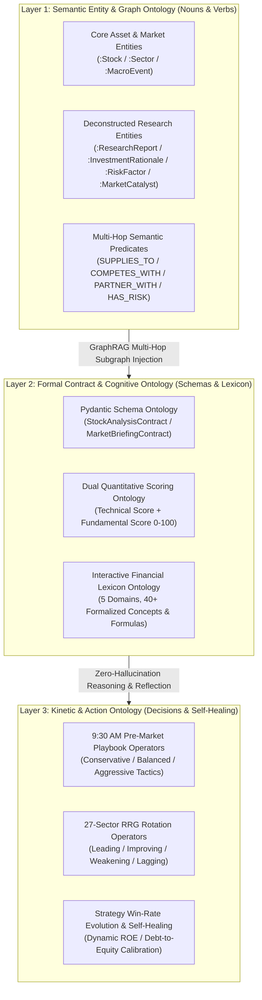
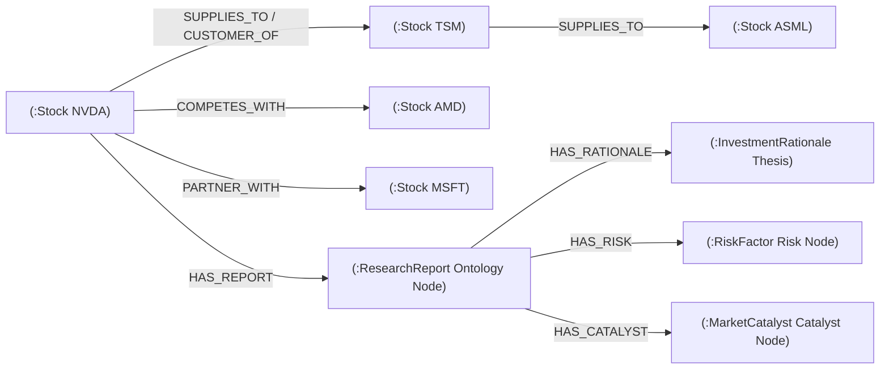

# Gems & DailyStock Algorithm, Financial Domain Ontology & Multimodal Data Architecture Whitepaper
*(Project Algorithm, Financial Domain Ontology & Multimodal Data Architecture Whitepaper — v3.0)*

---

## Table of Contents
1. [Core Architectural Philosophy: Three-Layer Financial Domain Ontology](#1-core-architectural-philosophy-three-layer-financial-domain-ontology)
2. [Heterogeneous Multimodal Database Architecture & Data Synergy](#2-heterogeneous-multimodal-database-architecture--data-synergy)
3. [Neo4j Knowledge Graph Ontology (GraphRAG): Five Entity Classes & Four Relationship Topologies](#3-neo4j-knowledge-graph-ontology-graphrag-five-entity-classes--four-relationship-topologies)
4. [Quantitative Screening, 27-Sector RRG & Trading Execution: 6 Core Dimensions](#4-quantitative-screening-27-sector-rrg--trading-execution-6-core-dimensions)
5. [Institutional Walk-Forward Backtest Lab & Statistical Rigor](#5-institutional-walk-forward-backtest-lab--statistical-rigor)
6. [Closed-Loop Win-Rate Evaluation & Seven Autonomous SRE Self-Healing Loops](#6-closed-loop-win-rate-evaluation--seven-autonomous-sre-self-healing-loops)

---

## 1. Core Architectural Philosophy: Three-Layer Financial Domain Ontology

In conventional AI financial applications, Large Language Models (LLMs) directly consume raw market JSON payloads, fragmented news snippets, and unstructured earnings transcripts—frequently producing financial hallucinations or vague, non-actionable commentary. **Gems & DailyStock** adopts a **Neuro-Symbolic Architecture** inspired by enterprise ontology engineering (**Palantir Foundry / AIP Ontology**). Between the raw data feeds and the generative AI reasoning layer, the system establishes a formal **Three-Layer Financial Domain Ontology**:

### 1.1 Layer 1: Semantic Entity & Graph Ontology ("Nouns & Verbs")
Defines the formal **Entity Classes** and **Object Properties (Directed Semantic Relations)** of the US equity ecosystem. Through `Neo4jGraphService`, isolated stock tickers are mapped into a living topological network encompassing upstream/downstream supply chains (`SUPPLIES_TO` / `CUSTOMER_OF`), direct peer competition (`COMPETES_WITH`), strategic ecosystem alliances (`PARTNER_WITH`), and deconstructed qualitative theses (`HAS_RATIONALE`, `HAS_RISK`, `HAS_CATALYST`).

### 1.2 Layer 2: Formal Contract & Bilingual Cognitive Ontology ("Rules & Schemas")
- **Pydantic Contract Ontology (`models.py`)**: Unconstrained free-text generation is replaced by strict Pydantic schemas (`StockAnalysisContract`, `MarketBriefingContract`, `VideoScriptContract`) acting as the Single Source of Truth. Every AI verdict is contractually required to bind explicit support levels (`key_supports`), resistance levels (`key_resistances`), directional sentiment (`sentiment`), and verifiable catalysts (`key_catalysts`).
- **Financial Lexicon Ontology (`TermTooltip.jsx`)**: A structured bilingual financial ontology spanning **5 core domains** (*Technical & Volume-Price*, *Fundamentals & Earnings NLP*, *Macro & RRG Rotation*, *Quant Backtesting & Risk*, and *Screening Strategies*). Each concept node encapsulates `{ summary, practical, formula, category }`, bridging machine reasoning and human cognitive clarity across desktop and mobile interfaces.

### 1.3 Layer 3: Kinetic & Action Ontology ("Decisions & Self-Healing")
An ontology not only models *what exists*, but governs *what actions must be taken under specific states*:
- **Pre-Market Anomaly Playbook Operators (`PremarketAnomalyService`)**: Maps pre-market price gaps, volume spikes, WSB retail sentiment, and short float ratios into formal tactical setups (`SHORT_SQUEEZE`, `GAP_AND_GO`) and generates risk-tailored 9:30 AM opening execution rules for `conservative`, `moderate`, and `aggressive` trading styles.
- **RRG Sector Rotation & Rebalancing Operators (`RotationSignalEngine` & `SectorActionEngine`)**: Translates 27-ETF trajectories in Relative Strength (`RS-Ratio`) and Relative Momentum (`RS-Momentum`) space into actionable sector overweight/underweight directives and 60/40 equity-bond drift warnings.

---

## 2. Heterogeneous Multimodal Database Architecture & Data Synergy

The platform employs a five-tier heterogeneous multimodal storage architecture combining **NoSQL Document DB + Graph Ontology DB + Private Research Vault + Object Storage + Stateful Circuit-Breaker Cache**:

| Storage Component | Database Type | Core Responsibilities & Stored Content |
| :--- | :--- | :--- |
| **Google Cloud Firestore** | NoSQL Document DB *(Core Business Store)* | • **Users & Zero-Trust Auth**: User profiles (`users/`), subscription tiers, delivery preferences. • **Research & Archives**: Daily holdings & watchlist reports (`reports/`), weekly audit recaps (`weekly_cache/`), macro analyses (`macro_cache/`), executive earnings NLP breakdowns (`earnings_archive/`). • **Strategies & Snapshots**: Gems rebalancing snapshots (`gems_rebalance_snapshots/`), SRE health probe states (`system_status`). |
| **Neo4j (AuraDB)** | Graph Database *(GraphRAG Ontology Engine)* | • **Industrial Supply Chain Topology**: Multi-hop chains (e.g., `NVDA → TSM → ASML`, `AAPL → Foxconn`). • **Multi-Hop Spillover Topologies (1–3 Hops)**: Sector contagion, competitor substitution, strategic alliances. • **Deconstructed Research Graph**: Maps reports into `:ResearchReport`, `:InvestmentRationale`, `:RiskFactor`, and `:MarketCatalyst` nodes. |
| **GCP Institutional Research Vault** | Cloud Document & Research Archive | • **1500+ Institutional Deep-Dive Reports**: Instant full-text search, category filtering, immersive reader, and one-click WeChat/Markdown publishing. |
| **Firebase Storage** | Object Storage | • **Rendered Multimodal Visuals**: Canvas 2.0 high-res PNG share cards, 6-Slide Earnings PPT posters, and HTML newsletter previews. |
| **In-Memory Stateful Cache** | Memory Cache & Circuit Breaker | • **High-Frequency Market & Q&A Hot Cache**: Cached FMP quotes, VWAP, moving averages, and 5-minute thread-safe `UnifiedQAEngine` hot cache. • **Circuit Breaker State Machine**: Seamless failover protecting against external API outages. |

---

## 3. Neo4j Knowledge Graph Ontology (GraphRAG): Five Entity Classes & Four Relationship Topologies

In [`backend/neo4j_service.py`](../backend/neo4j_service.py), the platform enforces a structured graph ontology via parameterized Cypher queries:

1. **Supply Chain Propagation (`SUPPLIES_TO` / `CUSTOMER_OF`)**: Models foundry, lithography, packaging, and hyperscaler procurement chains (`1..3` hops).
2. **Competitor & Peer Dynamics (`COMPETES_WITH`)**: Models direct market rivals to evaluate market-share shifts and earnings spillover effects.
3. **Strategic Ecosystem Partnerships (`PARTNER_WITH`)**: Models capital alliances and AI compute partnerships (`MSFT -[PARTNER_WITH]-> OpenAI`).
4. **Deconstructed Research & Event Factor Graph (`HAS_REPORT`, `HAS_RATIONALE`, `HAS_RISK`, `HAS_CATALYST`)**: Deconstructs qualitative reports into queryable graph nodes for multi-turn retrieval in `UnifiedQAEngine`.

---

## 4. Quantitative Screening, 27-Sector RRG & Trading Execution: 6 Core Dimensions

### ① Macroeconomic Liquidity & Two-Phase Event Reaction (P1 / P2)
- **Data Sources**: St. Louis Fed FRED API + FMP Economic Calendar (`FEDFUNDS`, `CPI`, `NFP`, `T10Y2Y` 10Y-2Y Yield Spread, `DGS10`, and Market Breadth).
- **Phase-1 (P1) & Phase-2 (P2) Dispatch**: Dispatches an instant **P1 Flash Brief** at $T+0.5\text{h}$ after major macro releases and a **P2 Institutional Digestion Report** at $T+4.0\text{h}$ to separate initial knee-jerk whipsaws from true institutional trend direction.

### ② 27-Sector Relative Rotation Graph (`RRGQuadrantChart`)
- Tracks **11 S&P 500 GICS Sector ETFs** (`XLK`, `XLF`, `XLV`, `XLY`, `XLC`, `XLI`, `XLP`, `XLE`, `XLU`, `XLRE`, `XLB`) plus **16 High-Alpha Thematic Sub-Sector ETFs** (`SMH`, `IGV`, `BOTZ`, `CIBR`, `SKYY`, `FDN`, `XBI`, `IHI`, `ITA`, `URA`, `GDX`, `COPX`, `ICLN`, `ITB`, `XRT`, `KRE`) across **Leading**, **Improving**, **Weakening**, and **Lagging** quadrants with 5-week rotation trails.

### ③ Quantitative Fundamental Score (0–100 Scale)
$$\text{Fundamental Score} = \text{ROE}(15\%) + \text{Gross Margin}(15\%) + \text{Revenue YoY}(20\%) + \text{EPS YoY}(20\%) + \text{FCF Yield}(20\%) + \text{Current Ratio}(10\%)$$

### ④ Technical Momentum Score (0–100 Scale) & Minervini Redline
$$\text{Technical Score} = 50\text{SMA Score}(40\%) + 200\text{SMA Score}(30\%) + 52\text{w Range Position Score}(30\%)$$
- Enforces the **Minervini Trend Redline** (resetting the 200SMA score to 0 if price drops $>20\%$ below the 200-day SMA) and powers the **9:30 AM Pre-Market Playbook**.

### ⑤ Earnings Surprise & Executive Call NLP Sentiment
- Combines quantitative EPS/Revenue beat margins with NLP tone analysis of management earnings calls.

### ⑥ 60/40 Equity-Bond Drift Radar & Scenario Stress Testing
- Monitors `SPY` vs. `BND` drift at $T-5$ and $T-2$ before month/quarter-end ($\ge 3.0\%$ threshold) and simulates portfolio drawdowns across 4 macro stress scenarios (*Tech Valuation Correction*, *Hawkish Rate Shock*, *Inflation Surge*, *Geopolitical Escalation*).

---

## 5. Institutional Walk-Forward Backtest Lab & Statistical Rigor

To eliminate look-ahead bias and overfitting, the built-in **Quant Backtest Lab (`BacktestLabView`)** provides:
1. **Four Core Quant Strategies with Transaction Friction**: Multi-Factor Composite (`multi_factor`), Momentum Breakout (`momentum_breakout`), RSI Mean Reversion (`rsi_mean_reversion`), and 50/200 SMA Golden Cross (`sma_crossover`), modeling explicit commission and slippage (`bps`).
2. **Institutional Risk-Adjusted Metrics**: **Lo (2002) Autocorrelation-Adjusted Sharpe Ratio** (with $t$-statistic and $p$-value significance testing), Sortino Ratio, Calmar Ratio, Max Drawdown & **Max Drawdown Duration (trading days)**, 95% Daily Historical **VaR** & **CVaR (Expected Shortfall)**, plus **Alpha ($\alpha$)**, **Beta ($\beta$)**, and **Information Ratio** vs. `SPY`.
3. **Single-Stock 52-Week AI Signal Backtest (`StockSignalBacktestModal`)**: Replays historical AI Buy/Sell signals on any individual equity against a passive Buy & Hold benchmark.

---

## 6. Closed-Loop Win-Rate Evaluation & Seven Autonomous SRE Self-Healing Loops

1. **Loop 1 — Pydantic Contract Reflection Engine**: Validates all LLM outputs against formal Pydantic schemas with up to 3 self-correcting reflection retries.
2. **Loop 2 — Stateful API Circuit Breaker**: Trips from `CLOSED` to `OPEN` after 3 consecutive FMP failures, routing seamlessly to `yfinance` and Firestore cache.
3. **Loop 3 — Weekly Cache Completeness Auditor**: Audits and auto-repairs missing `weekly_cache` entries every Saturday at 08:00 EST prior to 10:00 EST dispatch.
4. **Loop 4 — Strategy Win-Rate Evolution**: Tracks $T+5$ and $T+20$ trade expectancy:
   $$\text{Trade Expectancy} = (\text{Win Rate} \times \text{Average Win}) - (\text{Loss Rate} \times \text{Average Loss})$$
   Automatically tightens ROE and Debt/Equity thresholds if win rates dip below 50%.
5. **Loop 5 — Unhandled Exception SRE Reporter**: Captures HTTP 500 errors, reports to GCP Error Reporting, and dispatches stack-trace diagnostics to Discord.
6. **Loop 6 — Cloud Run Canary Auto-Rollback**: Verifies 10% canary traffic via `/api/v1/health/canary` across FMP, Firestore, Neo4j, and Gemini before full rollout.
7. **Loop 7 — Doc-Sync Governance Loop**: Keeps bilingual whitepapers, architecture specifications, and interactive web manuals continuously aligned with code contracts and ontology schemas.
